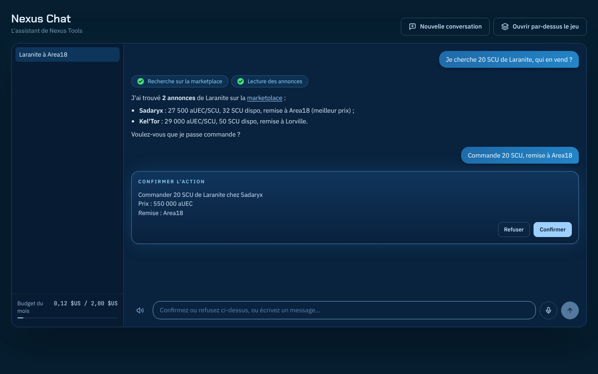
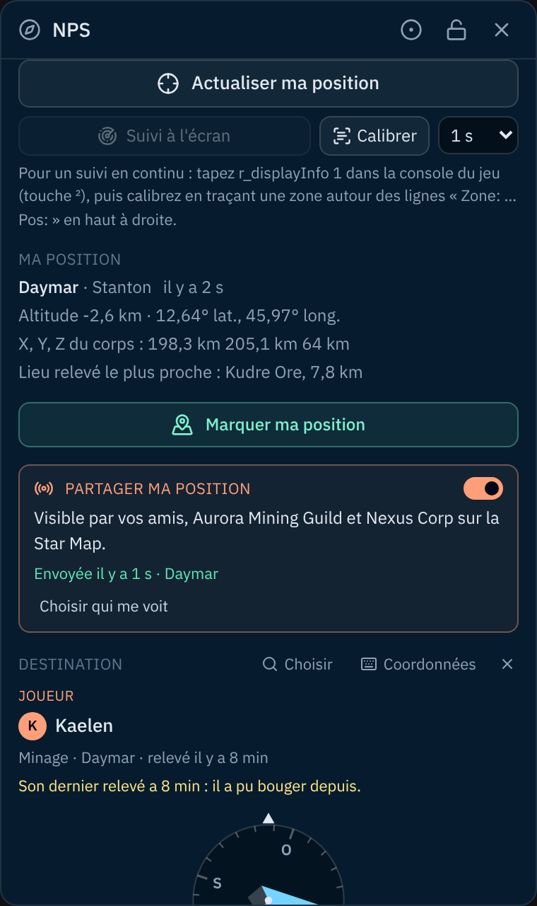
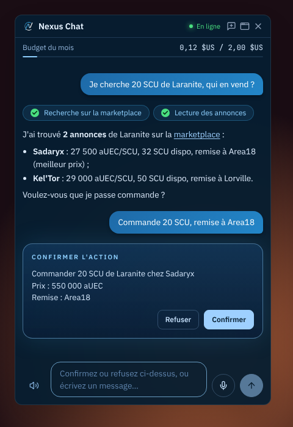
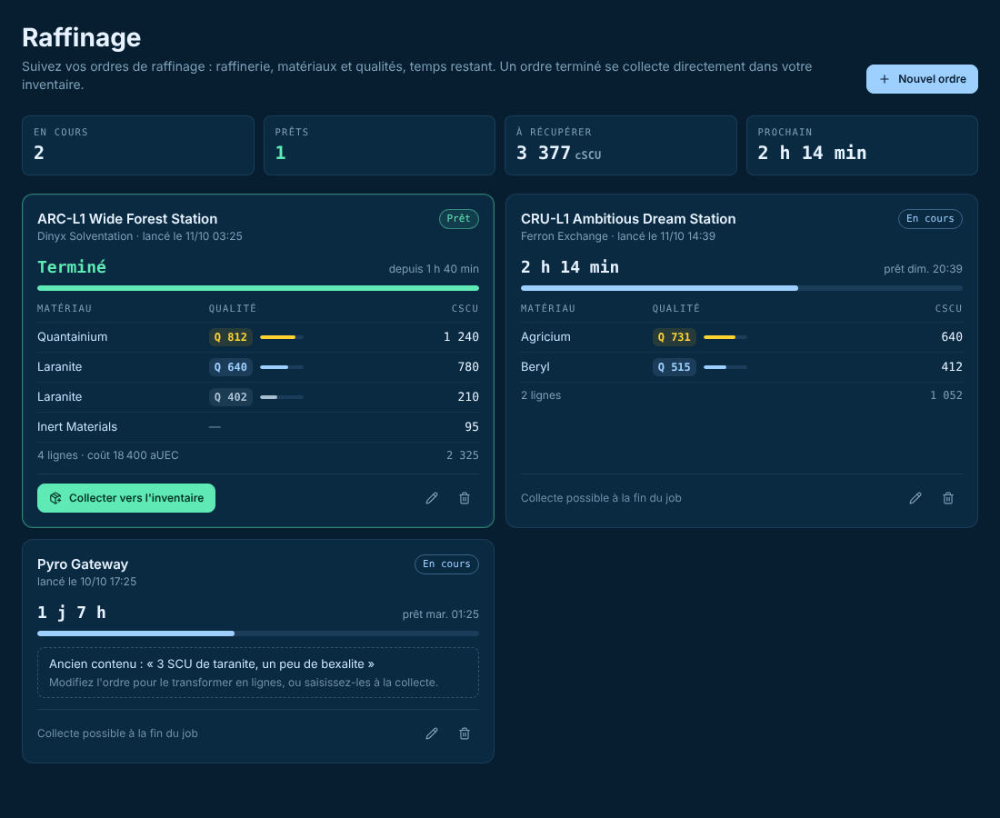
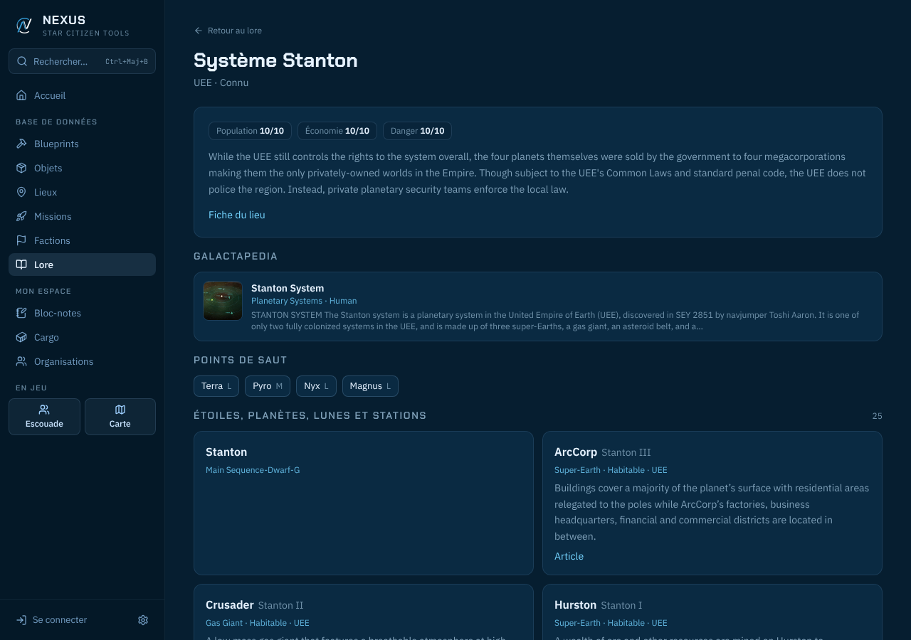

# Nexus App

**Nexus Tools par-dessus Star Citizen.**
Cherchez, notez, naviguez et parlez à votre escouade sans quitter le jeu.

[**Télécharger pour Windows**](https://github.com/NexusCorpSC/nexus-app/releases/latest) ·
[Nexus Tools](https://tools.services.nexus) ·
[Discord](https://tools.services.nexus/discord)

Nexus App est l'application de bureau de [Nexus Tools](https://tools.services.nexus),
la boîte à outils communautaire de Star Citizen. Elle affiche ses outils en
**superpositions** au-dessus du jeu, ouvertes et fermées par des raccourcis
clavier qui fonctionnent même quand Star Citizen a le focus.

Elle utilise votre compte Nexus Tools : inventaire, blueprints, amis,
organisations et notes sont les mêmes sur le site et dans l'application.
L'interface est disponible en français, en anglais et en espagnol.

## Installation

1. Téléchargez l'installeur `.exe` (ou `.msi`) de la
   [dernière version](https://github.com/NexusCorpSC/nexus-app/releases/latest).
2. Lancez-le : Nexus App s'installe et démarre.
3. Cliquez sur **Se connecter** : votre navigateur ouvre Nexus Tools ; une fois
   connecté (e-mail, Discord ou passkey), revenez dans l'application.

Nexus App fonctionne sous **Windows 10 et 11**. Elle vous prévient quand une
nouvelle version sort et s'installe d'un clic depuis **Paramètres › Mises à
jour**.

Fermer la fenêtre la range dans la zone de notification : les raccourcis
restent actifs. Pour quitter, clic droit sur l'icône Nexus › **Quitter**.

## Ce qu'elle fait en jeu

### Recherche instantanée

`Ctrl+Maj+B` ouvre une palette par-dessus le jeu : objets, blueprints,
missions, factions, boutiques et votre inventaire, en une seule recherche.
`Ctrl+Maj+S` capture une zone de l'écran et cherche le texte qu'elle contient.

### NPS, le GPS de Nexus

Le jeu donne votre position avec `/showlocation`, jamais votre direction. Le
NPS (`Ctrl+Maj+K`) s'en charge : il repère vos coordonnées, vous dit à quelle
distance est un lieu, un marqueur ou un ami, et dans quelle direction aller,
avec une boussole.

- Suivi en continu en lisant l'affichage de position à l'écran, ou relevé à
  la demande.
- **Marquer ma position** (`Ctrl+Maj+X`) pour enregistrer un point.
- **Partager ma position** avec vos amis et votre orga, qui vous voient sur la
  Star Map du site et peuvent vous rejoindre.
- Ajoutez les coordonnées d'un lieu qui n'en a pas encore : elles profitent à
  tous.

 

### Scanner de signature radar

Le scan du jeu affiche une signature radar au-dessus d'un rocher, d'un
astéroïde ou d'une épave. Le scanner (`Ctrl+Maj+R`) la lit à l'écran, dans une
zone que vous tracez une fois, et dit ce que c'est : quel minerai, quel type
d'astéroïde, et combien de rochers forment la grappe. Vous pouvez aussi taper
la valeur. Indiquez où vous scannez (vaisseau, ROC, à pied) pour que ce que
vous pouvez y croiser passe en tête. Les signatures connues viennent du site et
restent disponibles hors ligne.

### Navigation vers l'Aaron Halo

L'Aaron Halo, la ceinture d'astéroïdes de Stanton, n'a pas de balise de saut :
on y entre en coupant un saut quantique qui la traverse. La superposition
Aaron Halo (`Ctrl+Maj+A`) dit, pour un départ et une bande, à quelle distance
restante couper le saut (le nombre à surveiller au HUD), la marge dont vous
disposez, et les autres arrivées possibles. Une fois sorti du saut, le NPS lui
dit dans quelle bande vous êtes. Le même calcul est sur le site.

### Télémétrie du jeu

Star Citizen peut donner à l'app, sur votre PC seulement, votre solde aUEC,
votre santé, votre oxygène, le vaisseau où vous êtes assis, son carburant
hydrogène et quantum, sa vitesse et son altitude. La page **Télémétrie** les
affiche en direct, avec les dernières morts et réapparitions, et peut
déclencher des actions du jeu (carte stellaire, lampe, train
d'atterrissage…) ; celles qui sont sans retour, comme l'éjection ou
l'autodestruction, demandent une confirmation. Nexus Chat peut aussi les lire
(« combien de quantum me reste-t-il ? ») et déclencher une action à votre
demande.

Dans une escouade, l'app vous passe aussi **éliminé** dès que vous êtes à
terre ou mort, et **actif** à la réapparition (le jeu ne dit pas quand on vous
relève : repassez actif vous-même). Réglage dans **Paramètres › Jeu**.

Pour l'activer, dans **Paramètres › Jeu › Télémétrie du jeu**, jeu fermé :

1. **Définir à 1** la variable `GRPC_CLIENT_SERVER_ENABLED` (ou, dans
   PowerShell : `[Environment]::SetEnvironmentVariable('GRPC_CLIENT_SERVER_ENABLED','1','User')`),
   puis quitter complètement le RSI Launcher et le relancer.
2. **Activer** pour votre version du jeu : l'app ajoute `GameTelemetryEnabled`
   au fichier `attributes.xml`, après en avoir gardé une copie.

### Nexus Chat, à la voix

L'assistant de Nexus Tools en superposition (`Ctrl+Maj+H`). Demandez-lui un
prix, un lieu, un blueprint, ou de ranger un objet dans votre inventaire ;
toute action vous est montrée avant d'être faite. Maintenez `Ctrl+Maj+J` pour
lui parler au micro. **Échap** rend le clavier au jeu.

 

### Escouade, plan de vol et carte

- **Escouade** (`Ctrl+Maj+E`) : qui est prêt, qui est à terre, les annonces du
  chef avec un son, et les ready checks. Mêmes données que la page `/squads`
  du site, sur le téléphone de vos coéquipiers.
- **Plan de vol** (`Ctrl+Maj+P`) : la phase en cours du briefing préparé sur le
  site.
- **Carte** (`Ctrl+Maj+M`) : le plan d'un lieu, par-dessus le jeu.
- **Menu radial** (maintenir `Alt+V`) : les actions rapides, choisies à la
  souris.

### Bloc-notes et cargo

- **Bloc-notes** (`Ctrl+Maj+N`) : vos notes, synchronisées avec le site quand
  vous êtes connecté.
- **Feuille de cargo** (`Ctrl+Maj+G`) : votre chargement, rempli à la main ou
  depuis une capture d'écran de vos missions de livraison.

### Votre inventaire sans taper

Une capture d'écran de l'inventaire du jeu devient des lots dans votre
inventaire Nexus. L'application lit aussi le journal du jeu : quand vous
recevez un blueprint, une notification propose de l'ajouter à votre
collection.

## Dans la fenêtre principale

La fenêtre principale s'ouvre sur un accueil qui lance les superpositions et
montre votre escouade et vos notes. Elle donne accès à la base de données et à
votre espace :

- objets, blueprints, missions, factions, réputations et lieux ;
- inventaire personnel et d'organisation, colis entre joueurs ;
- ordres de raffinage, avec notification de fin et collecte vers l'inventaire ;
- marqueurs de position, lieux privés, amis et organisations, évènements ;
- commandes de la marketplace et tableau des demandes ;
- le lore du 'Verse (Galactapedia et starmap de RSI, en anglais).

| Raffinage | Lore |
| --- | --- |
|  |  |

## Raccourcis par défaut

| Raccourci | Effet |
| --- | --- |
| `Ctrl+Maj+B` | recherche |
| `Ctrl+Maj+S` | capture de zone et recherche du texte |
| `Ctrl+Maj+K` | NPS |
| `Ctrl+Maj+X` | marquer ma position |
| `Ctrl+Maj+R` | scanner de signature radar |
| `Ctrl+Maj+A` | navigation vers l'Aaron Halo |
| `Ctrl+Maj+H` | Nexus Chat |
| `Ctrl+Maj+J` (maintenu) | parler à Nexus Chat |
| `Ctrl+Maj+E` | escouade |
| `Ctrl+Maj+P` | plan de vol |
| `Ctrl+Maj+M` | carte |
| `Ctrl+Maj+N` | bloc-notes |
| `Ctrl+Maj+G` | feuille de cargo |
| `Ctrl+Maj+O` | masquer ou réafficher les superpositions |
| `Ctrl+Maj+L` | verrouiller les superpositions |
| `Alt+V` (maintenu) | menu radial |

Tous se changent dans **Paramètres**.

## Questions fréquentes

**Est-ce compatible avec l'anti-triche ?** L'application ne touche pas au jeu :
elle ne lit que le clavier (comme les autres overlays de la communauté), le
presse-papiers quand le NPS est ouvert, le journal `Game.log`, les captures
d'écran que vous déclenchez (et la zone calibrée du NPS ou du scanner radar) et, si vous l'activez, le service de télémétrie que
le jeu ouvre lui-même sur votre PC. Elle n'injecte rien dans le processus du
jeu.

**Un raccourci ne réagit pas.** Vérifiez dans **Paramètres** qu'il n'est pas
pris deux fois. Le journal de l'application, dans
`%LOCALAPPDATA%\services.nexus.app\logs\nexus-app.log`, note chaque raccourci
reçu.

**Le journal du jeu n'est pas lu.** Indiquez le dossier de Star Citizen dans
**Paramètres › Jeu** (par défaut
`C:\Program Files\Roberts Space Industries\StarCitizen\LIVE`).

**Un bug, une idée ?** Passez sur [Discord](https://tools.services.nexus/discord)
ou ouvrez une issue sur ce dépôt.

## Contribuer au code

L'application est faite avec Tauri (Rust) et React. La documentation
technique (installation, architecture, fonctionnement détaillé, publication)
est dans [docs/](docs/README.md).

---

Fait par la communauté Nexus Corporation. Ni approuvé, ni affilié à Cloud
Imperium. Les images et assets de Star Citizen appartiennent à Cloud Imperium
Games.
